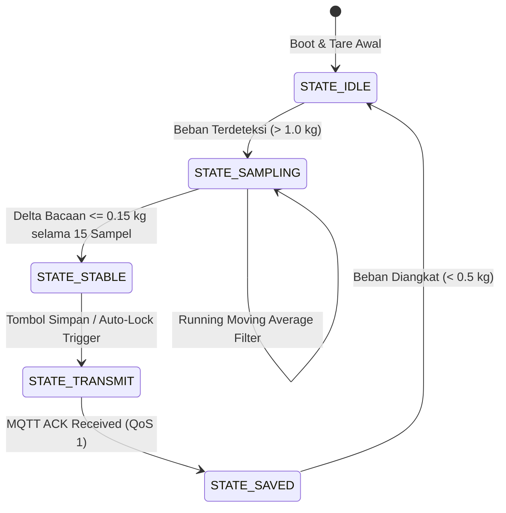

# 🏛️ Arsitektur Sistem Timbang & Susut RPHU

## 1. Desain Arsitektur Berlapis (4-Layer IoT Architecture)

Sistem dirancang mengadopsi pola arsitektur 4 lapis untuk menjamin modularitas, keandalan transmisi (*fault tolerance*), dan kemudahan ekspansi:

```mermaid
graph TD
    subgraph Layer 1: Perception Layer (Sensing & Hardware)
        LC["Load Cell Platform (4x Shear Beam / Single Point)"]
        HX["HX711 24-Bit Precision ADC"]
        ESP["ESP32 Dual-Core SoC (FreeRTOS)"]
        LCD["LCD2004 I2C Local Indicator"]
        BTN["Zero / Tare Push Buttons"]
        LC -->|Wheatstone Bridge mV| HX
        HX -->|2-Wire Serial (DT/SCK)| ESP
        ESP -->|I2C| LCD
        BTN -->|Interrupt GPIO| ESP
    end

    subgraph Layer 2: Network & Transport Layer
        WIFI["Industrial WiFi AP (2.4 GHz 802.11b/g/n)"]
        MQTT["Mosquitto MQTT Broker (QoS 1)"]
        ESP -->|Publish telemetry (JSON)| WIFI
        WIFI --> MQTT
    end

    subgraph Layer 3: Application & Processing Layer (Backend)
        PHP["PHP 8.2 MVC REST API Service"]
        SUB["MQTT Worker Subscriber (Daemon)"]
        CALC["Weight Calculation & Shrinkage Engine"]
        DB[(MySQL 8.0 Relational Database)]
        MQTT -->|Sub: rphu/scale/+/weight| SUB
        SUB --> CALC
        CALC -->|Store Weighing & Lot Audit| DB
        PHP <--> DB
    end

    subgraph Layer 4: Presentation Layer (Frontend Client)
        WEB["Industrial Web Dashboard (HTML5/CSS3/Vanilla JS)"]
        SIM["Integrated Scale Hardware Simulator"]
        WEB <-->|REST API JSON / SSE| PHP
        SIM -.->|Simulated Readings| WEB
    end
```

---

## 2. Alur Pipeline Data & State Machine Penimbangan

Penimbangan ayam hidup memiliki tantangan getaran mekanis yang tinggi karena pergerakan dan kepakan sayap ayam di dalam keranjang (*crate*). Oleh karena itu, firmware ESP32 menerapkan *Finite State Machine (FSM)* untuk deteksi kestabilan:



---

## 3. Algoritma Digital Filtering (Peredam Getaran Ayam Aktif)

Untuk menghasilkan nilai timbang yang akurat tanpa fluktuasi liar:
1. **Penyaringan Sampel Ekstrem (Outlier Rejection)**:
   Membaca sampel ADC sebanyak 10 kali pada rate 80 Hz (HX711 RATE pin diset HIGH). Nilai tertinggi dan terendah dibuang.
2. **Moving Average Filter Window ($N = 15$)**:
   $$\bar{W}_k = \frac{1}{N} \sum_{i=0}^{N-1} W_{k-i}$$
3. **Kriteria Kestabilan (Stability Window Detector)**:
   Bobot dinyatakan stabil apabila:
   $$\max(W_{k}, \dots, W_{k-N+1}) - \min(W_{k}, \dots, W_{k-N+1}) \le \epsilon_{stable}$$
   Di mana $\epsilon_{stable} = 0.15\text{ kg}$ (dapat dikonfigurasi).

---

## 4. Struktur Pesan MQTT (Telemetry Payload)

Topik publikasi telemetri timbangan:
- Topik: `rphu/scale/{device_id}/weight`
- Format Payload (JSON):
```json
{
  "device_id": "SCALE-ESP32-01",
  "station": "Timbang 1",
  "lot_id": "L-0610-01",
  "stage": "hidup",
  "weight_kg": 4841.5,
  "raw_adc": 8345920,
  "is_stable": true,
  "sample_count": 15,
  "timestamp": 1791787200,
  "rssi": -62
}
```

Topik perintah pengendali (Subscribe oleh ESP32):
- Topik: `rphu/scale/{device_id}/command`
- Payload: `{"action": "tare"}` atau `{"action": "zero"}` atau `{"action": "calibrate", "known_weight": 20.0}`

---

## 5. Toleransi dan Pengamanan Data (Anti-Tampering)
Dalam konteks RPHU komersial:
1. **Append-Only Weighing Records**: Nilai timbangan yang telah disimpan oleh operator tidak dapat di-update atau di-delete langsung. Jika terjadi kesalahan ketik atau keranjang tertinggal, operator wajib mencatat timbangan baru sebagai revisi dengan alasan tertulis di `audit_logs`.
2. **Offline Data Resiliency**: Apabila koneksi WiFi terputus saat proses bongkar muat berlangsung, ESP32 menyimpan hingga 500 transaksi penimbangan di memori flash lokal SPIFFS dan otomatis melakukan sinkronisasi ulang saat koneksi pulih.
