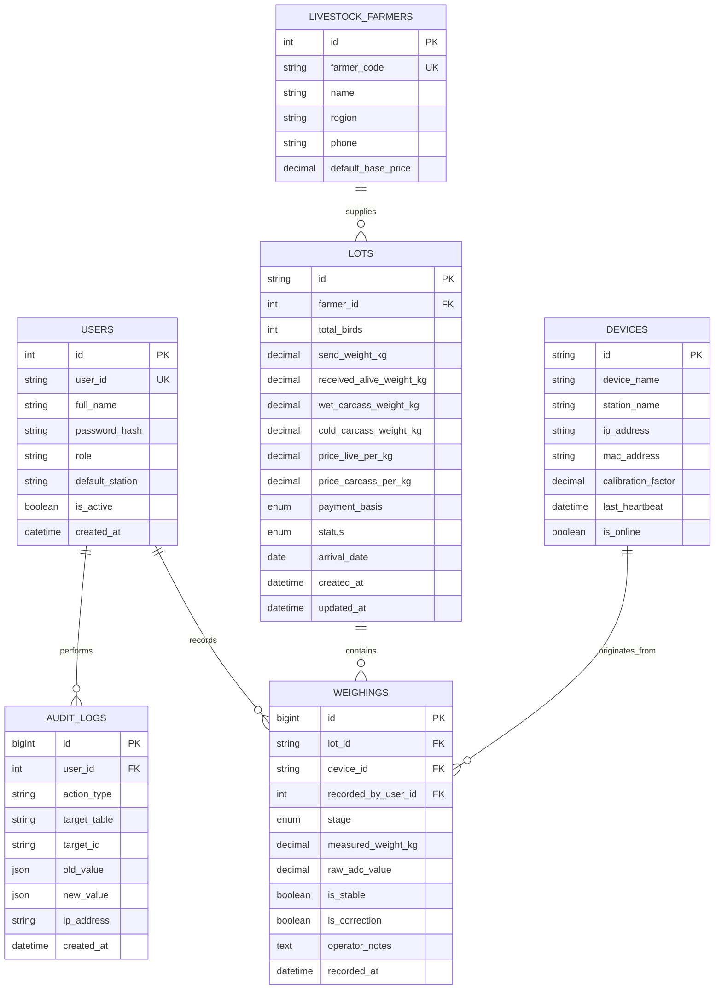

# 🗄️ Skema Database & Relasi Entitas (ERD)

Database menggunakan mesin MySQL 8.0 / MariaDB 10.11 dengan collation `utf8mb4_unicode_ci` dan engine `InnoDB` untuk mendukung transaksi ACID.

---

## 1. Diagram Relasi Entitas (ERD)

---

## 2. Kamus Data & Integritas Relasional

### A. Tabel `lots`
Menyimpan entitas batch kedatangan unggas per pengiriman truk/kandang.
- `id` (VARCHAR 32, PRIMARY KEY): Kode unik lot, contoh: `L-0610-01`.
- `send_weight_kg` (DECIMAL 10,2): Berat timbang di kandang asal.
- `received_alive_weight_kg` (DECIMAL 10,2): Berat saat ayam hidup tiba di RPHU.
- `wet_carcass_weight_kg` (DECIMAL 10,2): Berat karkas setelah pencabutan bulu & pengeluaran jeroan.
- `cold_carcass_weight_kg` (DECIMAL 10,2): Berat karkas akhir setelah keluar dari bak chilling / cold storage.
- `payment_basis` (ENUM): `'kirim'` (bayar berbasis berat kandang) atau `'terima'` (bayar berbasis berat tiba).

### B. Tabel `weighings`
Menyimpan riwayat transaksi pembacaan sensor timbangan. Tabel ini bersifat **Append-Only** (hanya `INSERT`, tidak ada `DELETE`).
- `stage` (ENUM): `'hidup'`, `'basah'`, `'dingin'`.
- `is_correction` (BOOLEAN): Bernilai `1` jika data dicatat untuk merevisi bacaan sebelumnya pada tahap yang sama.

### C. Tabel `audit_logs`
Merekam jejak audit keamanan seluruh aksi operator, login, dan modifikasi data harga atau status lot.
